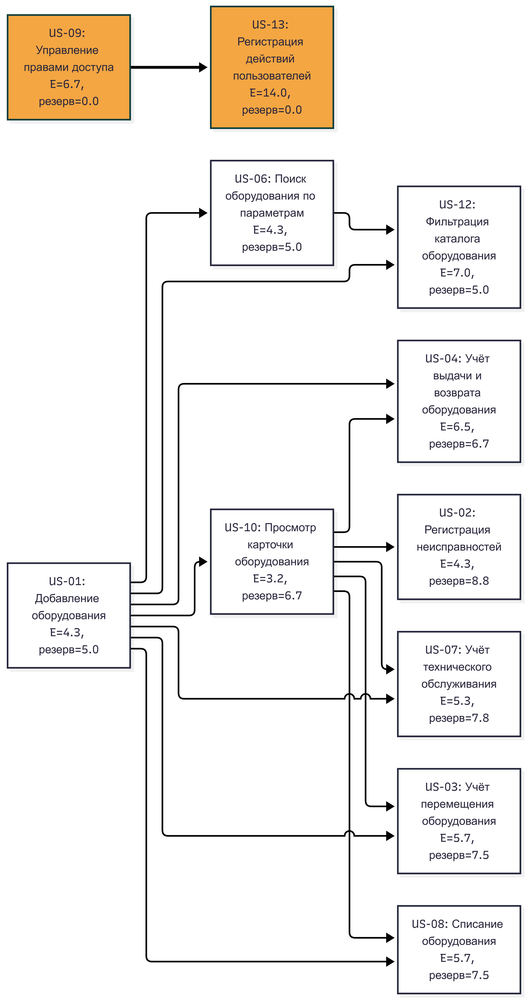

# 1. Построение сетевого графика, определение критического пути и резервов времени

**Сетевой график** — это графическое представление работ проекта и зависимостей между ними, которое показывает последовательность выполнения задач, возможность их параллельного выполнения и взаимосвязь между отдельными этапами проекта. Он используется для определения общей продолжительности проекта, выявления критического пути и расчёта резервов времени для каждой задачи.

Для планирования разработки MVP проекта «Учёт оборудования лаборатории» был построен сетевой график с использованием скрипта `pert_cpm.py`.

В график включены 11 пользовательских историй, входящих в MVP:

- **US-01** — Добавление оборудования;
- **US-02** — Регистрация неисправностей;
- **US-03** — Учёт перемещения оборудования;
- **US-04** — Учёт выдачи и возврата оборудования;
- **US-06** — Поиск оборудования по параметрам;
- **US-07** — Учёт технического обслуживания;
- **US-08** — Списание оборудования;
- **US-09** — Управление правами доступа;
- **US-10** — Просмотр карточки оборудования;
- **US-12** — Фильтрация каталога оборудования;
- **US-13** — Регистрация действий пользователей.

Для построения графика использовались оценки продолжительности выполнения историй по методу PERT: оптимистичная (O), наиболее вероятная (M) и пессимистичная (P). Ожидаемая продолжительность каждой истории рассчитывалась по формуле:

$$
E = \frac{O + 4M + P}{6}
$$

На основании зависимостей между историями были определены последовательность выполнения работ и возможность их параллельного выполнения.

В проекте предусмотрены следующие зависимости:

- US-02 зависит от US-10: для регистрации неисправности необходимо иметь возможность просматривать карточку оборудования.
- US-12 зависит от US-01 и US-06: фильтрация каталога предполагает наличие оборудования в системе и возможность поиска по параметрам.
- US-13 зависит от US-09: регистрация действий пользователей связана с предварительной настройкой прав доступа.

Остальные истории не имеют заданных зависимостей и могут выполняться параллельно.

## Сетевой график

На рисунке 1 представлен сетевой график разработки MVP. Он отражает зависимости между пользовательскими историями, ожидаемую продолжительность выполнения и резервы времени. Критический путь выделен оранжевым цветом.

**Рисунок 1 — Сетевой график разработки MVP.**

## Результаты расчёта

По результатам выполнения скрипта `pert_cpm.py` были получены следующие значения:

| ID истории | Ожидаемая длительность E, ч | Резерв времени, ч |
| ---------- | --------------------------: | ----------------: |
| US-01      |                        4,33 |              5,00 |
| US-02      |                        4,33 |              8,83 |
| US-03      |                        5,67 |              7,50 |
| US-04      |                        6,50 |              6,67 |
| US-06      |                        4,33 |              5,00 |
| US-07      |                        5,33 |              7,83 |
| US-08      |                        5,67 |              7,50 |
| US-09      |                        6,67 |              0,00 |
| US-10      |                        3,17 |              6,67 |
| US-12      |                        7,00 |              5,00 |
| US-13      |                       14,00 |              0,00 |

## Критический путь

**Критический путь** — это самая продолжительная по времени последовательность взаимосвязанных задач проекта, определяющая минимально возможный срок его завершения. Задачи, входящие в критический путь, имеют нулевой резерв времени, поэтому задержка выполнения любой из них приводит к увеличению общей продолжительности проекта.

По результатам расчёта был определён критический путь:

**US-09 → US-13**

Он включает две пользовательские истории:

1. US-09 — Управление правами доступа: 6,67 часа.
2. US-13 — Регистрация действий пользователей: 14 часов.

Общая ожидаемая продолжительность критического пути составляет:

$$
T_{кр} = 6{,}67 + 14 = 20{,}67 \text{ часа}
$$

Таким образом, ожидаемая продолжительность разработки MVP с учётом заданных зависимостей составляет **20,67 часа**.

Обе истории критического пути имеют нулевой резерв времени. Это означает, что задержка выполнения любой из этих историй приведёт к увеличению общего срока завершения проекта, если остальные условия и оценки останутся неизменными.

## Резервы времени

Резерв времени показывает, на сколько можно задержать выполнение задачи, не изменив рассчитанный срок завершения всего проекта.

Наибольший резерв имеет US-02 «Регистрация неисправностей» — **8,83 часа**. Это означает, что выполнение данной истории можно задержать на указанное время без изменения общего срока проекта.

Истории US-09 «Управление правами доступа» и US-13 «Регистрация действий пользователей» имеют нулевой резерв, поэтому требуют особого внимания при планировании и контроле выполнения работ.

## Вывод

В результате построения сетевого графика были определены зависимости между пользовательскими историями MVP, рассчитаны ожидаемая продолжительность выполнения каждой истории и резервы времени. Установлено, что критический путь проходит через истории US-09 «Управление правами доступа» и US-13 «Регистрация действий пользователей» и составляет 20,67 часа.

Полученные результаты позволяют определить задачи, требующие первоочередного контроля, оценить допустимые задержки по остальным историям и спланировать параллельное выполнение работ, не имеющих прямых зависимостей друг от друга.

**Примечание:** 20,67 часа — это расчётная продолжительность по текущим оценкам PERT и заданным зависимостям, а не фактический срок разработки MVP. Расчёт предполагает, что задачи могут выполняться параллельно при наличии необходимых ресурсов. Если команда выполняет их последовательно или имеет ограниченную ёмкость, календарная продолжительность будет другой.

## 2. Оценка вероятности завершения MVP к дате защиты ЛР 3 по методу PERT

Для оценки вероятности завершения MVP к дате защиты лабораторной работы № 3 используется метод PERT (Program Evaluation and Review Technique). Это метод оценки продолжительности проекта, который учитывает неопределённость сроков выполнения задач. Для каждой задачи задаются три оценки продолжительности: оптимистичная (O), наиболее вероятная (M) и пессимистичная (P).

Ожидаемая продолжительность каждой задачи рассчитывается по формуле:

$$
E = \frac{O + 4M + P}{6}
$$

На основании оценок продолжительности задач и зависимостей между историями был построен сетевой график и определён критический путь проекта.

**Критический путь** — это самая продолжительная по времени последовательность взаимосвязанных задач проекта, определяющая минимально возможный срок его завершения. Задачи, входящие в критический путь, имеют нулевой резерв времени, поэтому задержка любой из них приводит к увеличению общей продолжительности проекта.

По результатам расчёта критический путь MVP состоит из двух историй:

- US-09 — «Управление правами доступа»;
- US-13 — «Регистрация действий пользователей».

Ожидаемая продолжительность US-09 составляет 6,67 часа, а US-13 — 14 часов. Следовательно, ожидаемая продолжительность критического пути равна:

$$
T_e = 6{,}67 + 14 = 20{,}67 \text{ часа}
$$

Это значение является ожидаемой продолжительностью критического пути с учётом зависимостей между задачами, а не суммой продолжительности всех историй MVP.

### Расчёт стандартного отклонения критического пути

**Стандартное отклонение** показывает степень неопределённости продолжительности выполнения задач. Сначала оно рассчитывается отдельно для каждой задачи по формуле:

$$
\sigma_i = \frac{P-O}{6}
$$

Для US-09 оптимистичная оценка составляет 2 часа, а пессимистичная — 14 часов:

$$
\sigma_1 = \frac{14-2}{6} = 2
$$

Для US-13 оптимистичная оценка составляет 4 часа, а пессимистичная — 32 часа:

$$
\sigma_2 = \frac{32-4}{6} \approx 4{,}67
$$

Для определения стандартного отклонения всего критического пути используется формула:

$$
\sigma_{CP} = \sqrt{\sigma_1^2+\sigma_2^2}
$$

Подставим полученные значения:

$$
\sigma_{CP} = \sqrt{2^2+4{,}67^2} \approx 5{,}08 \text{ часа}
$$

Таким образом, стандартное отклонение критического пути составляет 5,08 часа. При расчёте предполагается независимость продолжительности задач.

### Определение доступного времени команды

Для оценки возможности завершения MVP к защите ЛР 3 учитывается период с 30 октября по 13 ноября 2026 года. Таким образом, в распоряжении команды остаётся 2 недели.

Команда состоит из двух участников, каждый из которых может выделять на проект 20 часов в неделю. Для учёта неполной эффективной загрузки используется коэффициент 0,6.

Общее доступное эффективное время команды рассчитывается по формуле:

$$
T = N \times W \times H \times K
$$

где:

- N — количество участников команды (2);
- W — количество недель до защиты (2);
- H — количество часов работы одного участника в неделю (20);
- K — коэффициент эффективной загрузки (0,6).

Подставим значения:

$$
T = 2 \times 2 \times 20 \times 0{,}6 = 48
$$

Таким образом, за две недели команда располагает 48 эффективными часами.

Для оценки продолжительности критического пути отдельно учитывается доступное время одного участника, поскольку задачи критического пути выполняются последовательно.

$$
T_1 = 2 \times 20 \times 0{,}6 = 24 \text{ часа}
$$

Следовательно, один участник располагает 24 эффективными рабочими часами за две недели.

### Расчёт вероятности завершения по критическому пути

Для оценки вероятности завершения критического пути в установленный срок используется формула:

$$
Z = \frac{T_1-T_e}{\sigma_{CP}}
$$

где:

- T₁ — доступное время одного участника (24 часа);
- Tₑ — ожидаемая продолжительность критического пути (20,67 часа);
- σCP — стандартное отклонение критического пути (5,08 часа).

Подставим значения:

$$
Z = \frac{24-20{,}67}{5{,}08} \approx 0{,}66
$$

Полученное значение Z используется для определения вероятности завершения критического пути по стандартному нормальному распределению.

При Z = 0,66 вероятность составляет приблизительно 74,5%.

Таким образом, при условии, что один участник последовательно выполняет задачи критического пути и располагает 24 эффективными рабочими часами до защиты, вероятность завершения критического пути в установленный срок составляет около 74,5%.

### Вывод

Согласно предварительной оценке методом PERT, ожидаемая продолжительность критического пути MVP составляет 20,67 часа, а стандартное отклонение — 5,08 часа.

При условии, что один участник последовательно выполняет задачи критического пути и располагает 24 эффективными рабочими часами до защиты, вероятность завершения критического пути в установленный срок составляет приблизительно 74,5%.

Полученный результат показывает, что у команды есть возможность завершить критический путь до даты защиты ЛР 3, однако сохраняется риск задержки.

Для дополнительной проверки расчётов скрипт `pert_cpm.py` был запущен с параметром `--deadline 24`. В качестве срока использовано доступное эффективное время одного участника за две недели.

Результат работы скрипта подтвердил предыдущие вычисления:

- ожидаемая продолжительность критического пути — 20,67 часа;
- стандартное отклонение — 5,08 часа;
- вероятность завершения критического пути за 24 часа — 74,4%.

Таким образом, результат программного расчёта практически совпадает с ручным вычислением. Небольшое расхождение (74,4% вместо 74,5%) связано с округлением промежуточных значений.

## 3. Прогноз методом Монте-Карло

**Метод Монте-Карло** — это метод математического моделирования, который позволяет оценивать возможные результаты и вероятность их наступления с помощью многократного проведения случайных экспериментов.

В управлении проектами данный метод применяется для прогнозирования сроков выполнения работ с учётом неопределённости. Вместо определения одного фиксированного срока проводится множество симуляций, в каждой из которых случайным образом выбираются значения пропускной способности команды. По результатам моделирования можно оценить, за какое время будет выполнен весь бэклог с определённой вероятностью.

### 3.1. Исходные данные

Поскольку у команды пока нет собственной истории пропускной способности, для моделирования используются условные значения, указанные в задании.

В качестве исходных данных приняты:

- **История пропускной способности:** 1, 2, 3 и 4 истории в неделю.
- **Средняя пропускная способность:** 2,5 истории в неделю.
- **Размер бэклога:** 11 историй MVP.
- **Количество симуляций:** 10 000.
- **Единица измерения:** недели.

Значения от 1 до 4 отражают возможное количество историй, которое команда может завершить за одну неделю. В каждой симуляции случайным образом выбирается одно из этих значений, после чего количество выполненных историй суммируется до тех пор, пока не будет завершён весь бэклог.

### 3.2. Проведение моделирования

Для выполнения расчёта использован предоставленный преподавателем скрипт `monte_carlo.py`.

**Результаты моделирования:**

| Периодов (недель) | Доля симуляций | Накопленная доля |
| ----------------: | -------------: | ---------------: |
|                 3 |           6,3% |             6,3% |
|                 4 |          36,3% |            42,6% |
|                 5 |          36,1% |            78,7% |
|                 6 |          16,5% |            95,2% |
|                 7 |           4,2% |            99,4% |
|                 8 |           0,6% |           100,0% |
|                 9 |           0,0% |           100,0% |
|                10 |           0,0% |           100,0% |

### 3.3. Результаты моделирования

На основании полученного распределения определены следующие прогнозы:

- **P50 — 5 недель.** С вероятностью 50% команда завершит весь бэклог не позднее чем за 5 недель.
- **P70 — 5 недель.** С вероятностью 70% команда завершит весь бэклог не позднее чем за 5 недель.
- **P85 — 6 недель.** С вероятностью 85% команда завершит весь бэклог не позднее чем за 6 недель.
- **P95 — 6 недель.** С вероятностью 95% команда завершит весь бэклог не позднее чем за 6 недель.

Согласно распределению результатов, за 5 недель бэклог был выполнен в 78,7% симуляций, а за 6 недель — в 95,2% симуляций.

Это означает, что срок в 5 недель соответствует уровням уверенности P50 и P70, а срок в 6 недель обеспечивает уровни уверенности P85 и P95.

### 3.4. Вывод

В результате моделирования методом Монте-Карло получен прогноз срока выполнения MVP, состоящего из 11 историй. При использовании условной пропускной способности от 1 до 4 историй в неделю ожидаемый срок составляет 5 недель с уровнем уверенности P50 и 6 недель с уровнем уверенности P85.

Таким образом, для планирования проекта целесообразно ориентироваться на срок **6 недель**, поскольку он обеспечивает вероятность завершения всего бэклога около 95% согласно результатам моделирования. Это позволяет учесть возможные колебания пропускной способности команды и заложить более реалистичный срок выполнения MVP.
