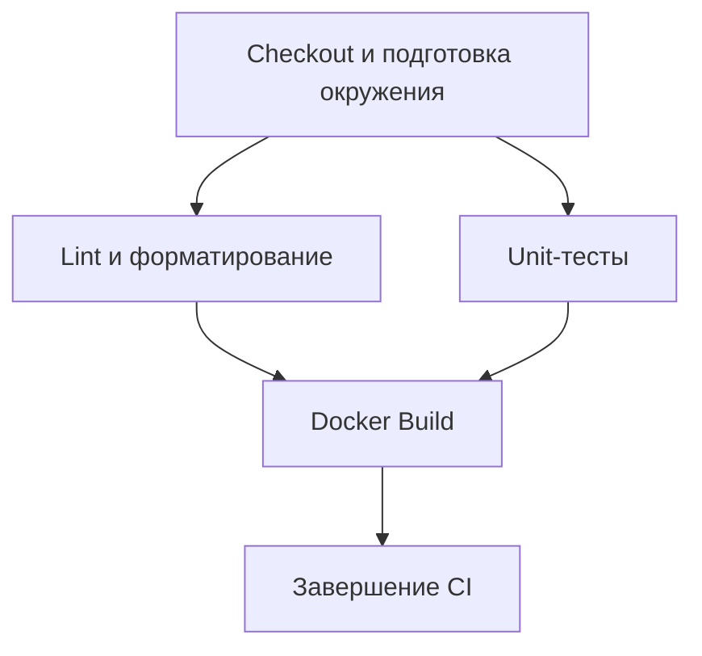

# Оптимизация CI-конвейера

## 1. Базовая линия

За базовую линию принят **Go CI V1 — Baseline**: последовательный конвейер без кэширования Go-зависимостей и Docker BuildKit cache.

Результаты пяти запусков:

|      Запуск |          Время |
|------------:|---------------:|
|           1 |     1 мин 32 с |
|           2 |     2 мин 02 с |
|           3 |     1 мин 57 с |
|           4 |     1 мин 59 с |
|           5 |     1 мин 41 с |
| **Медиана** | **1 мин 57 с** |

Медиана базовой линии составляет **117 секунд**.

### Этапы базового конвейера

В базовом варианте этапы выполняются последовательно:

1. Checkout — получение исходного кода.
2. Setup Go — установка требуемой версии Go.
3. Install dependencies — загрузка Go-зависимостей.
4. Check formatting — проверка форматирования через `gofmt`.
5. Run linter — статический анализ через `golangci-lint`.
6. Run tests — запуск тестов.
7. Build Docker image — сборка Docker-образа.

## 2. Применённые оптимизации

### V1 — Baseline

Исходный последовательный конвейер:
- кэш Go-зависимостей отключён;
- Docker-образ собирается без использования BuildKit cache;
- все этапы выполняются в одной job.

Медианное время: **117 секунд**.

### V2 — Кэширование Go-зависимостей

В `actions/setup-go` включено кэширование Go-модулей:

```yaml
with:
  go-version-file: src/backend/go.mod
  cache: true
  cache-dependency-path: src/backend/go.sum
```

Это позволяет повторно использовать загруженные Go-зависимости при последующих запусках, если ключ кэша соответствует текущим файлам зависимостей.

Медианное время: **84 секунды**.

### V3 — Кэширование слоёв Docker

Для сборки используется Docker Buildx и `docker/build-push-action`. Добавлен GitHub Actions cache для слоёв Docker:

```yaml
cache-from: type=gha,scope=backend
cache-to: type=gha,mode=max,scope=backend
```

Это позволяет повторно использовать неизменившиеся слои образа между запусками.

Медианное время: **44 секунды**.

### V4 — Параллельное выполнение jobs

Конвейер разделён на независимые jobs:
- `lint` — форматирование и статический анализ;
- `test` — запуск тестов;
- `docker` — сборка Docker-образа.

Сборка Docker-образа зависит от успешного завершения проверок `lint` и `test` через `needs`. Проверки lint и test выполняются параллельно, а Docker-сборка запускается после них.

Медианное время: **50 секунд**.

### V5 — Отмена устаревших запусков (concurrency)

Добавлена настройка:

```yaml
concurrency:
  group: go-ci-${{ github.workflow }}-${{ github.ref }}
  cancel-in-progress: true
```

Если для той же группы уже выполняется CI, новый запуск отменяет предыдущий.

Медианное время: **48 секунд**.

## 3. Сравнение результатов

| Версия | Оптимизация                 | Запуски, с             |   Медиана | Изменение к V1 |
|--------|-----------------------------|------------------------|----------:|---------------:|
| V1     | Базовый последовательный CI | 92, 122, 117, 119, 101 | **117 с** |              — |
| V2     | Кэш Go-зависимостей         | 84, 87, 68, 79, 93     |  **84 с** |         −28,2% |
| V3     | Кэш слоёв Docker            | 47, 53, 44, 44, 39     |  **44 с** |         −62,4% |
| V4     | Параллельные jobs           | 45, 50, 56, 41, 50     |  **50 с** |         −57,3% |
| V5     | Concurrency                 | 48, 44, 44, 51, 48     |  **48 с** |         −59,0% |

### Диаграмма «до / после»

Медианное время полного конвейера:

```text
V1 Baseline       117 с | ███████████████████████
V2 Go Cache        84 с | █████████████████
V3 Docker Cache    44 с | █████████
V4 Parallel Jobs   50 с | ██████████
V5 Concurrency     48 с | ██████████
```

## 4. Критический путь конвейера

В V1–V3 этапы выполняются последовательно. Поэтому критический путь включает все шаги job: от checkout до завершения Docker-сборки. Время критического пути равно полному времени выполнения job.

В V4–V5 структура изменена:
- jobs `lint` и `test` запускаются параллельно;
- job `docker` ожидает завершения обеих jobs через `needs`;
- следовательно, критический путь проходит через более долгую из двух проверок (`lint` или `test`), а затем через Docker-сборку.



# Оптимизация Frontend CI-конвейера

## 1. Базовая линия

За базовую линию принят **Frontend CI V1 — Baseline**: последовательный конвейер без кэширования npm-зависимостей и Docker BuildKit cache.

Результаты пяти запусков:

|      Запуск |    Время |
| ----------: | -------: |
|           1 |     27 с |
|           2 |     25 с |
|           3 |     30 с |
|           4 |     31 с |
|           5 |     30 с |
| **Медиана** | **30 с** |

Медиана базовой линии составляет **30 секунд**.

### Этапы базового конвейера

В базовом варианте этапы выполняются последовательно:

1. Set up job — подготовка среды выполнения GitHub Actions.
2. Checkout — получение исходного кода.
3. Setup Node.js — установка требуемой версии Node.js.
4. Install dependencies — установка npm-зависимостей через `npm ci`.
5. Check formatting — проверка форматирования через Prettier.
6. Run linter — статический анализ через ESLint.
7. Run tests — запуск модульных тестов через Vitest.
8. Build Docker image — сборка Docker-образа.

Медианное время отдельных этапов:

| Этап                 | Медианное время |
| -------------------- | --------------: |
| Set up job           |             1 с |
| Checkout             |             1 с |
| Setup Node.js        |             1 с |
| Install dependencies |             4 с |
| Check formatting     |             1 с |
| Run linter           |             2 с |
| Run tests            |             3 с |
| Build Docker image   |            14 с |

Наиболее затратным этапом является сборка Docker-образа — 14 секунд. Она занимает значительную часть общего времени конвейера. Установка npm-зависимостей занимает 4 секунды.

## 2. Применённые оптимизации

### V1 — Baseline

Исходный последовательный конвейер:

- кэширование npm-зависимостей отключено;
- Docker-образ собирается без использования BuildKit cache;
- все этапы выполняются последовательно в одной job.

Медианное время: **30 секунд**.

### V2 — Кэширование npm-зависимостей

В `actions/setup-node` включено кэширование npm-зависимостей:

```yaml
with:
  node-version: 22
  cache: npm
  cache-dependency-path: src/frontend/package-lock.json
```

Это позволяет повторно использовать кэш npm между запусками при совпадении ключа кэша, определяемого на основе файла зависимостей.

Медианное время: **37 секунд**.

В проведённых измерениях ускорения не наблюдалось: медианное время увеличилось относительно базовой линии. Это может быть связано с изменением времени выполнения отдельных этапов и особенностями среды GitHub Actions.

### V3 — Кэширование слоёв Docker

Для сборки используется Docker Buildx и `docker/build-push-action`. Добавлен GitHub Actions cache для слоёв Docker:

```yaml
cache-from: type=gha,scope=frontend
cache-to: type=gha,mode=max,scope=frontend
```

Это позволяет повторно использовать неизменившиеся слои Docker-образа между запусками и сокращать время повторной сборки.

Медианное время: **29 секунд**.

### V4 — Параллельное выполнение jobs

Конвейер разделён на независимые jobs:

- `lint` — проверка форматирования и статический анализ;
- `test` — запуск модульных тестов;
- `docker` — сборка Docker-образа.

Проверки `lint` и `test` выполняются параллельно. Сборка Docker-образа зависит от успешного завершения обеих проверок через `needs`.

Таким образом, независимые проверки не ожидают завершения друг друга, а Docker-сборка начинается после их успешного выполнения.

Медианное время полного конвейера: **43 секунды**.

### V5 — Отмена устаревших запусков и фильтры путей

Добавлена настройка `concurrency`:

```yaml
concurrency:
  group: frontend-ci-${{ github.workflow }}-${{ github.ref }}
  cancel-in-progress: true
```

Если для той же группы уже выполняется CI, новый запуск отменяет предыдущий.

Также добавлены фильтры путей для запуска Frontend CI только при изменениях файлов Frontend и соответствующих workflow:

```yaml
pull_request:
  paths:
    - "src/frontend/**"
    - ".github/workflows/frontend-v*.yml"
```

Эти настройки позволяют отменять устаревшие запуски и не запускать Frontend CI при изменениях, не относящихся к Frontend.

Медианное время полного конвейера: **43 секунды**.

## 3. Сравнение результатов

| Версия | Оптимизация                 | Запуски, с         |  Медиана | Изменение к V1 |
| ------ | --------------------------- | ------------------ | -------: | -------------: |
| V1     | Базовый последовательный CI | 27, 25, 30, 31, 30 | **30 с** |              — |
| V2     | Кэш npm-зависимостей        | 26, 37, 38, 43, 31 | **37 с** |         +23,3% |
| V3     | Кэш слоёв Docker            | 45, 24, 29, 30, 25 | **29 с** |          −3,3% |
| V4     | Параллельные jobs           | 66, 39, 34, 43, 43 | **43 с** |         +43,3% |
| V5     | Concurrency и фильтры путей | 60, 45, 37, 43, 31 | **43 с** |         +43,3% |

Положительное изменение означает увеличение времени выполнения, отрицательное — сокращение относительно базовой линии.

### Диаграмма «до / после»

Медианное время полного конвейера:

```text
V1 Baseline       30 с | ███████████████
V2 npm Cache      37 с | ███████████████████
V3 Docker Cache   29 с | ██████████████
V4 Parallel Jobs  43 с | ██████████████████████
V5 Concurrency    43 с | ██████████████████████
```

Результаты показывают, что не все оптимизации привели к сокращению фактического времени отдельного запуска. Наилучший результат по медиане времени показала V3 с Docker cache — 29 секунд.

Параллельное выполнение jobs, concurrency и фильтры путей дополнительно оптимизируют организацию CI-процесса и использование вычислительных ресурсов.

### Дополнительное сравнение jobs в V4 и V5

В V4 и V5 независимые jobs выполняются параллельно. Поэтому для анализа структуры конвейера дополнительно рассмотрено время отдельных jobs и расчётный критический путь.

**V4 — Parallel Jobs**

| Запуск | Lint | Tests | Docker | Сумма jobs | Критический путь |
| ------ | ---: | ----: | -----: | ---------: | ---------------: |
| 1      |  9 с |  19 с |   40 с |       68 с |             59 с |
| 2      | 13 с |  14 с |   17 с |       44 с |             31 с |
| 3      | 10 с |  15 с |   11 с |       36 с |             26 с |
| 4      | 10 с |  16 с |   20 с |       46 с |             36 с |
| 5      |  9 с |  14 с |   21 с |       44 с |             35 с |

Медиана расчётного критического пути: **35 секунд**.

**V5 — Concurrency**

| Запуск | Lint | Tests | Docker | Сумма jobs | Критический путь |
| ------ | ---: | ----: | -----: | ---------: | ---------------: |
| 1      | 11 с |  13 с |   41 с |       65 с |             54 с |
| 2      | 11 с |  17 с |   20 с |       48 с |             37 с |
| 3      | 13 с |  13 с |   16 с |       42 с |             29 с |
| 4      | 15 с |  18 с |   16 с |       49 с |             34 с |
| 5      |  8 с |  12 с |   12 с |       32 с |             24 с |

Медиана расчётного критического пути: **34 секунды**.

Сумма jobs показывает общее время работы отдельных задач, а критический путь — последовательность зависимостей, определяющую минимальное время завершения конвейера без учёта накладных расходов.

## 4. Критический путь конвейера

В V1–V3 этапы выполняются последовательно. Поэтому критический путь включает все шаги job: от получения исходного кода и подготовки окружения до завершения Docker-сборки.

В V4–V5 структура изменена:

- jobs `lint` и `test` запускаются параллельно;
- job `docker` ожидает завершения обеих jobs через `needs`;
- критический путь проходит через более долгую из двух проверок (`lint` или `test`), а затем через Docker-сборку.

Расчёт критического пути:

```text
T = max(T_lint, T_test) + T_docker
```

Схема параллельного выполнения:


По результатам измерений медиана расчётного критического пути составляет 35 секунд для V4 и 34 секунды для V5.
