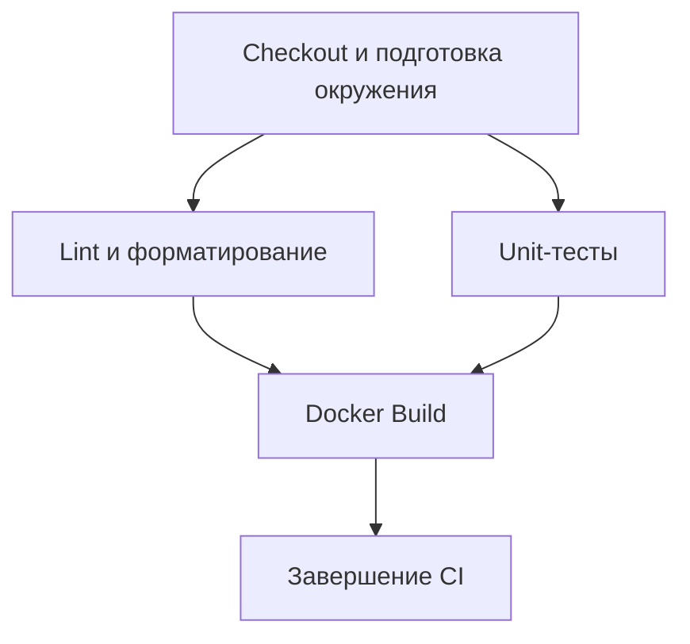

# Оптимизация CI-конвейера

## 1. Базовая линия

За базовую линию принят **Go CI V1 — Baseline**: последовательный конвейер без кэширования Go-зависимостей и Docker BuildKit cache.

Результаты пяти запусков:

|      Запуск |          Время |
|------------:|---------------:|
|           1 |     1 мин 32 с |
|           2 |     2 мин 02 с |
|           3 |     1 мин 57 с |
|           4 |     1 мин 59 с |
|           5 |     1 мин 41 с |
| **Медиана** | **1 мин 57 с** |

Медиана базовой линии составляет **117 секунд**.

### Этапы базового конвейера

В базовом варианте этапы выполняются последовательно:

1. Checkout — получение исходного кода.
2. Setup Go — установка требуемой версии Go.
3. Install dependencies — загрузка Go-зависимостей.
4. Check formatting — проверка форматирования через `gofmt`.
5. Run linter — статический анализ через `golangci-lint`.
6. Run tests — запуск тестов.
7. Build Docker image — сборка Docker-образа.

## 2. Применённые оптимизации

### V1 — Baseline

Исходный последовательный конвейер:
- кэш Go-зависимостей отключён;
- Docker-образ собирается без использования BuildKit cache;
- все этапы выполняются в одной job.

Медианное время: **117 секунд**.

### V2 — Кэширование Go-зависимостей

В `actions/setup-go` включено кэширование Go-модулей:

```yaml
with:
  go-version-file: src/backend/go.mod
  cache: true
  cache-dependency-path: src/backend/go.sum
```

Это позволяет повторно использовать загруженные Go-зависимости при последующих запусках, если ключ кэша соответствует текущим файлам зависимостей.

Медианное время: **84 секунды**.

### V3 — Кэширование слоёв Docker

Для сборки используется Docker Buildx и `docker/build-push-action`. Добавлен GitHub Actions cache для слоёв Docker:

```yaml
cache-from: type=gha,scope=backend
cache-to: type=gha,mode=max,scope=backend
```

Это позволяет повторно использовать неизменившиеся слои образа между запусками.

Медианное время: **44 секунды**.

### V4 — Параллельное выполнение jobs

Конвейер разделён на независимые jobs:
- `lint` — форматирование и статический анализ;
- `test` — запуск тестов;
- `docker` — сборка Docker-образа.

Сборка Docker-образа зависит от успешного завершения проверок `lint` и `test` через `needs`. Проверки lint и test выполняются параллельно, а Docker-сборка запускается после них.

Медианное время: **50 секунд**.

### V5 — Отмена устаревших запусков (concurrency)

Добавлена настройка:

```yaml
concurrency:
  group: go-ci-${{ github.workflow }}-${{ github.ref }}
  cancel-in-progress: true
```

Если для той же группы уже выполняется CI, новый запуск отменяет предыдущий.

Медианное время: **48 секунд**.

## 3. Сравнение результатов

| Версия | Оптимизация                 | Запуски, с             |   Медиана | Изменение к V1 |
|--------|-----------------------------|------------------------|----------:|---------------:|
| V1     | Базовый последовательный CI | 92, 122, 117, 119, 101 | **117 с** |              — |
| V2     | Кэш Go-зависимостей         | 84, 87, 68, 79, 93     |  **84 с** |         −28,2% |
| V3     | Кэш слоёв Docker            | 47, 53, 44, 44, 39     |  **44 с** |         −62,4% |
| V4     | Параллельные jobs           | 45, 50, 56, 41, 50     |  **50 с** |         −57,3% |
| V5     | Concurrency                 | 48, 44, 44, 51, 48     |  **48 с** |         −59,0% |

### Диаграмма «до / после»

Медианное время полного конвейера:

```text
V1 Baseline       117 с | ███████████████████████
V2 Go Cache        84 с | █████████████████
V3 Docker Cache    44 с | █████████
V4 Parallel Jobs   50 с | ██████████
V5 Concurrency     48 с | ██████████
```

## 4. Критический путь конвейера

В V1–V3 этапы выполняются последовательно. Поэтому критический путь включает все шаги job: от checkout до завершения Docker-сборки. Время критического пути равно полному времени выполнения job.

В V4–V5 структура изменена:
- jobs `lint` и `test` запускаются параллельно;
- job `docker` ожидает завершения обеих jobs через `needs`;
- следовательно, критический путь проходит через более долгую из двух проверок (`lint` или `test`), а затем через Docker-сборку.


